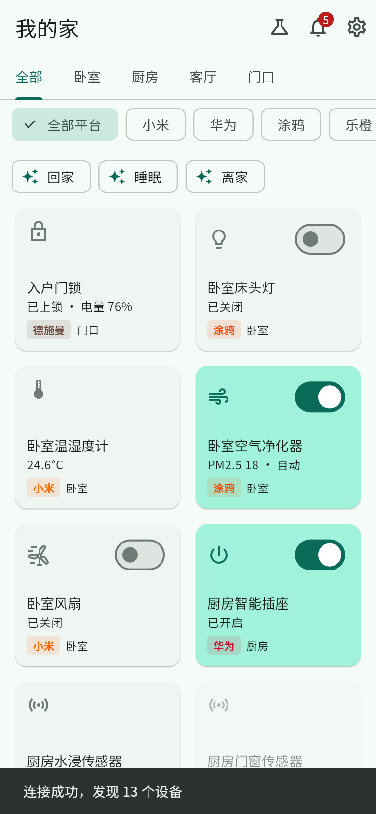
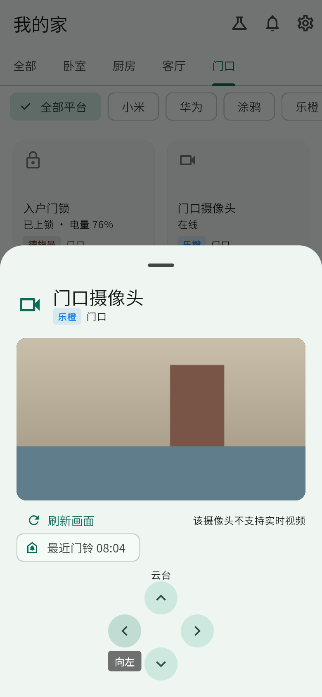
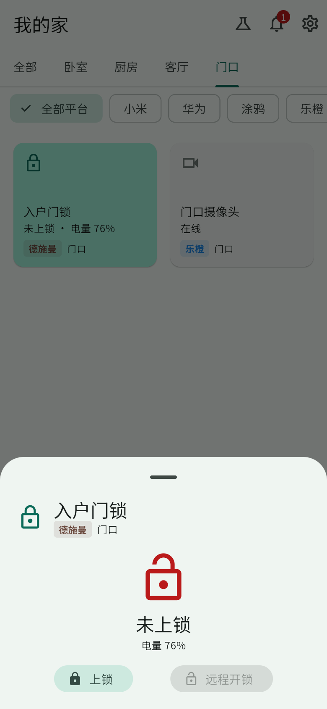
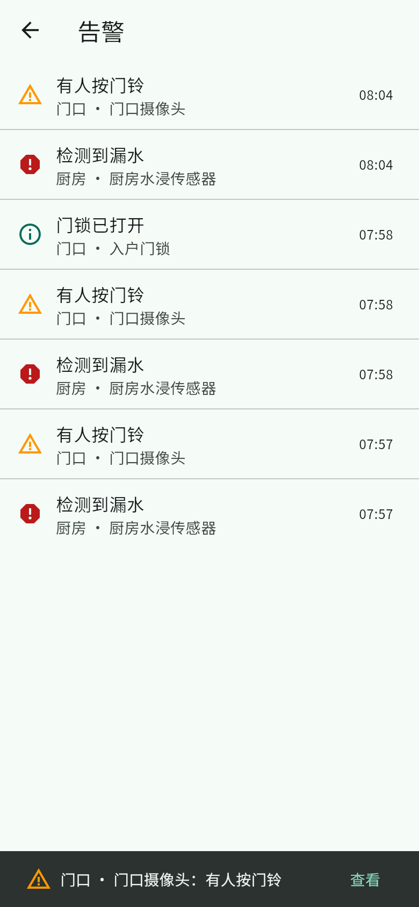

# 智能家居统一控制平台

一个移动 App 统一控制 **小米（米家）**、**华为（智慧生活）**、**涂鸦（智能生活）**、**乐橙**、**德施曼** 等生态的设备。

```
Flutter App  ──REST / WebSocket──▶  统一网关 (FastAPI)  ──▶  Home Assistant  ──▶  小米 / 涂鸦 / Matter 设备
```

- `mobile/` — Flutter App：按房间、按平台浏览设备，开关 / 调光 / 色温 / 空调 / 窗帘 / 风扇 / 净化器控制，门锁（PIN 开锁），摄像头画面与实时视频，一键场景，告警（漏水 / 烟雾 / 门锁 / 低电量等），实时状态推送
- `backend/` — 统一网关：把各平台设备转换成统一模型，对 App 提供 REST 和 WebSocket 接口
- `docs/architecture.md` — 架构设计、**各平台接入可行性（华为需要重点看）**、接口说明、路线图
- `docs/testing.md` — **测试指南**：演示模式下逐项验证的功能清单

<p>
  
  
  
  
</p>

## 快速体验（演示模式，不需要真实设备）

一条命令启动网关和网页版 App（需要 Docker）：

```bash
docker compose -f docker-compose.demo.yml up --build
```

浏览器（电脑或同一局域网的手机）打开 `http://<本机IP>:8000/`，令牌 `devtoken`，演示门锁的开锁 PIN 是 `2468`。首页右上角的烧瓶图标是「演示工具」，可以模拟漏水、门铃、门锁卡住等事件。

Android 手机安装包：GitHub 仓库 → Actions → 最新一次 CI → Artifacts 下载 `smart-home-apk`。完整测试步骤见 [docs/testing.md](docs/testing.md)。

不用 Docker 时：

```bash
cd backend && pip install -e ".[dev]"
```

```bash
GATEWAY_TOKEN=devtoken GATEWAY_UNLOCK_PIN=2468 GATEWAY_ADAPTERS=mock uvicorn gateway.main:app --factory --host 0.0.0.0 --port 8000
```

```bash
cd mobile && flutter run
```

App 需要 Flutter 3.44 或更高版本，Android 7.0 及以上。Android 模拟器里网关地址填 `http://10.0.2.2:8000`。

## 接入真实设备

1. 复制 `.env.example` 为 `.env`，设置 `GATEWAY_TOKEN`。
2. `docker compose up -d homeassistant matter-server`，浏览器打开 `http://<服务器IP>:8123` 完成 HA 初始化。
3. 在 HA 中添加集成：
   - 小米：通过 HACS 或手动安装 [Xiaomi Home](https://github.com/XiaoMi/ha_xiaomi_home)，用小米账号登录；
   - 涂鸦：设置 → 设备与服务 → 添加 `Tuya`，用「智能生活」App 扫码；
   - 华为：通过 HACS 安装社区集成 [Huawei SmartHome](https://github.com/xiasi0/ha-huawei-smarthome)，用华为账号登录（非官方，不可商用，先核对设备是否在其支持列表中）；支持 Matter 的设备也可用 `Matter` 集成配对。详见 `docs/architecture.md` 第 2 节。
   - 乐橙：通过 HACS 安装官方集成 [Imou Life](https://github.com/Imou-OpenPlatform/Imou-Home-Assistant)，AppId / AppSecret 在 open.imou.com 创建应用获取，区域选「中国」；
   - 德施曼：通过 HACS 安装社区集成 [desmanlock](https://github.com/chliny/ha-desmanlock)，用德施曼账号登录（开锁需 HA 主机在门锁蓝牙范围内，不能远程上锁）；
   - 空气净化器（「智能生活 - 智慧家居」App）：就是涂鸦，按上面涂鸦的方式接入；
   - 360：目前没有可用的接入方式，见 `docs/architecture.md` 第 2 节。
4. 在 HA 中给设备分配区域（即 App 中的房间），生成长期访问令牌填入 `.env` 的 `HA_TOKEN`。需要远程开锁时设置 `GATEWAY_UNLOCK_PIN`。
5. `docker compose up -d --build gateway`。手机安装 APK 或浏览器打开 `http://<服务器IP>:8000/`。
6. 场景在 HA 里创建（设置 → 自动化与场景 → 场景 / 脚本），会自动出现在 App 首页。

## 测试

```bash
cd backend && pytest
```

```bash
cd mobile && flutter test
```
