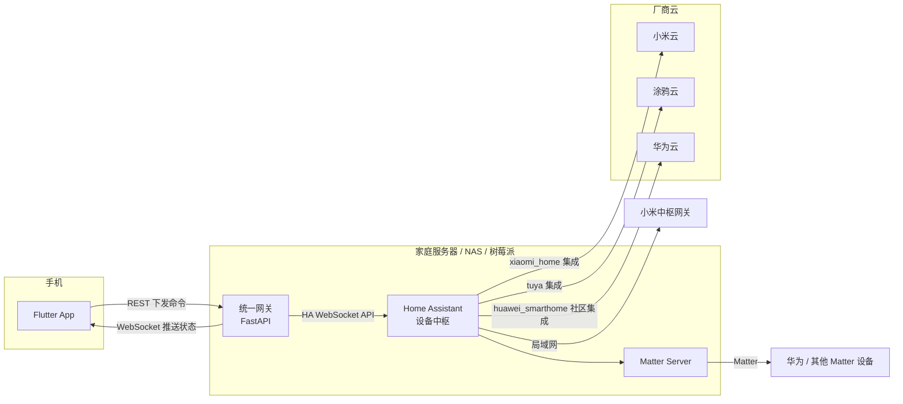

# 智能家居统一控制平台 — 架构设计

## 1. 目标

用一个移动 App（Android / iOS）统一控制多个生态的设备：

| 生态 | App | 本文简称 |
| --- | --- | --- |
| 小米 / 米家 | 米家（小米生活） | 小米 |
| 华为 HiLink | 华为智慧生活 | 华为 |
| 涂鸦 | 智能生活（Smart Life，App Store 上名为「智能生活 - 智慧家居」） | 涂鸦 |
| 乐橙 | 乐橙（监控） | 乐橙 |
| 德施曼 | 德施曼智能（门锁） | 德施曼 |
| 360 | 360 智能家居（摄像机、门铃等） | 360 |

App 中按房间、按平台浏览设备，完成开关、调光、空调、窗帘、风扇、空气净化器、门锁等控制，查看摄像头画面，并实时看到状态变化。

## 2. 关键结论：各平台能否接入

这是整个项目最大的不确定性，决定了架构。

| 平台 | 官方开放程度 | 推荐接入方式 | 风险 |
| --- | --- | --- | --- |
| 小米 | 有官方 HA 集成 | Home Assistant 安装小米官方集成 [XiaoMi/ha_xiaomi_home](https://github.com/XiaoMi/ha_xiaomi_home)，用小米账号 OAuth 登录；有小米中枢网关时可局域网控制 | 低 |
| 涂鸦 | 开放程度最高 | HA 内置 `tuya` 集成，用「智能生活」App 扫码登录，不需要涂鸦开发者账号；需要本地控制可用社区的 `tuya-local` | 低 |
| 华为 | **没有官方的第三方控制接口**，有活跃的社区集成 | 社区 HA 集成 `huawei_smarthome`（见下文） | **中高** |
| 乐橙 | 有官方开放平台和官方 HA 集成 | 乐橙开放平台官方集成 [Imou-OpenPlatform/Imou-Home-Assistant](https://github.com/Imou-OpenPlatform/Imou-Home-Assistant)（HACS 名称 "Imou Life"，域名 `imou_life`）。在 open.imou.com 创建应用拿 AppId / AppSecret，区域选「中国」。支持实时视频、云台、隐私模式、移动侦测、门铃事件等 | 低 |
| 德施曼 | 无官方接口，有社区集成 | 社区集成 [chliny/ha-desmanlock](https://github.com/chliny/ha-desmanlock)（域名 `desmanlock`），德施曼账号登录，走德施曼云 | 中，见下文 |
| 360 | **无开放接口，也没找到可用的社区集成** | 暂不接入，见下文 | **高** |
| 智能生活 - 智慧家居 | — | 这就是涂鸦的「智能生活」App（开发者 Volcano Technology Limited，即涂鸦），空气净化器走上面的涂鸦集成即可，不需要单独对接 | 低 |

### 华为的情况

华为智慧生活开放平台（HiLink）面向**设备厂商**：它让厂商把自己的设备接进华为生态，而不是让第三方 App 从华为生态里读取、控制设备。官方渠道拿不到「列出我家华为设备并控制」的接口。

GitHub 上的社区方案（2026-10 调研）：

| 项目 | 原理 | 覆盖 | 状态 | 适用性 |
| --- | --- | --- | --- | --- |
| [xiasi0/ha-huawei-smarthome](https://github.com/xiasi0/ha-huawei-smarthome) | HA 自定义集成。华为账号密码登录（支持短信 / 设备挑战码二次验证），走华为云，MQTT 接收状态推送（`cloud_push`） | 204 个型号，按 prodId 逐个适配：灯、开关、插座、窗帘、传感器、空调、门锁、智慧屏、音箱等 | 活跃（2026-10-27 仍在发版），GPL-3.0，标注 Experimental | **首选**。网关已按集成名 `huawei_smarthome` 把它的设备归为华为 |
| [0xlic/ha-huawei-hilink-opple](https://github.com/0xlic/ha-huawei-hilink-opple) | HA 集成，局域网 UDP 5686，HiLink 本地协议（CoAP + AES-CBC + HMAC-SHA256）。authCode 用辅助工具从华为账号获取一次 | 仅验证欧普 MX420 / MX480 吸顶灯 | 个人项目，极早期 | 只说明 HiLink 设备存在本地协议；可作为本地控制的参考实现 |
| ha_hwhomebridge 系列（如 [Huoberber/ha_hwhomebridge](https://github.com/Huoberber/ha_hwhomebridge)） | **方向相反**：把 HA 里的设备接进华为智慧生活 / 小艺。依赖闭源 .so 和 HiLink SDK | — | 原仓库已删除，现存的都是 fork | 不解决本项目的问题；如果以后想让华为 App / 小艺也能控制小米、涂鸦设备，可以参考 |

另外，GitHub 上大量名为 "hilink" 的 Python / Go 库是华为 **4G 上网卡、路由器** 的接口，与智能家居无关。

**使用 `ha-huawei-smarthome` 的风险**

- 非官方、未经华为授权，作者声明仅供学习研究、**不得商用**。本项目如果做成商业产品，不能依赖它，需要走 Matter 或与华为洽谈生态合作。
- 用账号密码登录华为云，华为调整接口或风控时可能失效，存在账号被限制的风险。
- 只有已写适配器的型号才会出现，接入前先在其 [supported-devices.md](https://github.com/xiasi0/ha-huawei-smarthome/blob/master/docs/supported-devices.md) 中按 prodId 核对自家设备。不在列表里的设备需要自己写适配器（`device_adapters/prod_<prodId>.py`）。
- 依赖华为云，外网断开时无法控制。

**接入路线（按推荐顺序）**

1. **ha-huawei-smarthome**：自用 / 家庭场景首选，覆盖面最大。
2. **Matter**：设备本身支持 Matter 时，通过 HA 的 Matter 集成接入（`docker-compose.yml` 已包含 Matter Server），完全本地、官方协议。每个型号需单独确认。
3. **品牌自有通道**：很多 HiLink 设备是第三方品牌（欧普、杜亚、领普等），品牌可能有自己的 HA 集成，或同款设备有米家 / 涂鸦版本。
4. **替换方案**：空调、电视等可用红外遥控器、智能插座间接控制。

**建议**：先列出家里（或目标用户）的华为设备清单，对照上面的设备列表逐个确认路线。

### 德施曼

[chliny/ha-desmanlock](https://github.com/chliny/ha-desmanlock)（GPL-3.0，2026-10 仍在更新）提供门锁状态、开锁记录、电量、抓拍图片和密码管理。限制：

- **只能开锁不能上锁**：德施曼官方 App 本身没有远程上锁命令，门锁靠自动上锁。
- **开锁走蓝牙**：HA 主机（或 ESPHome 蓝牙代理）必须在门锁蓝牙范围内，不是云端远程开锁。
- 锁状态从最近一次开锁 / 自动上锁记录推断，可能比实际慢。
- 使用 ID2 安全芯片协议的型号不支持。

另有 [w-sguang/ha-xiaodi](https://github.com/w-sguang/ha-xiaodi)（小嘀 / 德施曼，只读：开锁记录与联动事件）。部分德施曼型号也在华为智慧生活（如 SHEP-SL0-DN）或米家生态中，可以走对应平台的集成。

### 360

360 摄像机、门铃不提供 RTSP / ONVIF，视频流加密传输，GitHub 上没有可用的 HA 集成；论坛里的方案只能做到定时拉取门铃录像或在 App 里跳转到 360 官方 App。建议：

- 已有的 360 设备继续用 360 官方 App；
- 新购监控设备选乐橙、或支持 RTSP / ONVIF 的摄像头（HA 内置 ONVIF / Generic Camera 集成可接入）。

网关已预留 `qihoo360` 平台标识（按厂商名 `qihoo` 识别），以后有可用的接入方式时 App 不用改。

## 3. 总体架构



### 为什么用 Home Assistant 做中枢

- 小米和涂鸦都有官方维护的 HA 集成，自己对接两家云 API 的工作量和维护成本远高于直接复用。
- HA 支持 Matter、Zigbee、HomeKit 等通用协议，华为及其他品牌的设备可以通过这些协议接入。
- 设备发现、令牌刷新、断线重连、局域网控制这些麻烦事都由 HA 处理。

### 为什么不让 App 直连 Home Assistant，而要加一层网关

- **统一设备模型**：HA 的实体模型很细（一个空调可能有十几个实体），网关把它们过滤、整理成 App 需要的「设备」，App 不需要理解 HA。
- **安全**：HA 的长期令牌权限极大（可以改配置、执行任意服务）。令牌只放在网关里，手机上只有一个只能控制设备的网关令牌。
- **可替换上游**：网关用适配器模式，以后如果某个平台需要直连云 API（比如拿到了华为的合作资质），只需加一个适配器，App 不用改。
- **扩展空间**：多用户、家庭共享、权限、操作日志、远程访问的云中继，都适合放在网关这一层。

## 4. 代码结构

```
backend/                 统一网关（Python 3.11+, FastAPI）
  gateway/
    models.py            统一设备模型：Device / Command / Platform / Action / Alert
    hub.py               DeviceHub：聚合适配器、设备缓存、告警检测、事件广播
    alerts.py            告警规则与告警记录（SQLite）
    main.py              REST + WebSocket 接口、开锁 PIN 校验、网页版托管
    config.py            环境变量配置
    adapters/
      base.py            适配器接口
      home_assistant.py  HA WebSocket 客户端（鉴权、同步、订阅、重连、截图、HLS 转发）
      ha_mapping.py      HA 实体 <-> 统一设备 的转换规则（含多实体合并）
      mock.py            演示设备、演示场景、演示工具
  tests/                 单元测试 + 假 HA 服务的协议测试
mobile/                  Flutter App（Android / iOS / 网页版）
  lib/
    models/                     设备、告警模型（与网关一致）
    services/gateway_client.dart REST / WebSocket 客户端
    state/device_store.dart     设备状态、告警、断线重连、命令下发
    state/settings_store.dart   网关地址、令牌（安全存储）、告警已读位置
    theme/app_theme.dart        「温暖居家」主题：配色、圆角、每类设备的强调色，支持深色模式
    screens/                    底部导航框架、首页、场景、告警、我的、演示工具、摄像头实时画面、设置
    widgets/                    设备卡片、场景按钮、控制面板、门锁、摄像头（截图 + 云台）、净化器
    web_fonts.dart              网页版中文字体加载
    demo/demo_gateway.dart      内置演示网关（不需要服务器；与网关的演示模式保持一致）
  web/                          网页版入口；字体与 CanvasKit 本地化，不依赖 Google CDN
tools/subset_cjk_font.py 生成网页版中文字体子集
Dockerfile               网关 + 网页版 App 镜像
docker-compose.yml       HA + Matter Server + 网关
docker-compose.demo.yml  演示模式（只有网关）
.github/workflows/ci.yml 测试、构建 APK / 网页版 / Docker 镜像
.github/workflows/pages.yml 把演示网页版发布到 GitHub Pages
render.yaml / .devcontainer/ 云端演示（Render、Codespaces）
```

## 5. 统一设备模型

```jsonc
{
  "id": "ha:light.living_room",      // "<适配器>:<原始ID>"，网关据此路由命令
  "name": "客厅吸顶灯",
  "type": "light",                    // light | switch | climate | cover | fan | sensor | binary_sensor
  "platform": "xiaomi",               // xiaomi | huawei | tuya | other
  "room": "客厅",
  "online": true,
  "state": { "on": true, "brightness": 80, "color_temp_kelvin": 4000 },
  "capabilities": ["turn_on", "turn_off", "toggle", "set_brightness", "set_color_temp"]
}
```

- `capabilities` 决定 App 显示哪些控件，App 不按设备型号写死逻辑。
- `state` 的字段约定见 `backend/gateway/models.py` 中 `Device` 的注释。
- 平台判断规则在 `ha_mapping.py`：先看 HA 集成名（`xiaomi_home`、`tuya` 等），再看设备厂商名。

## 6. 接口

所有接口（除 `/api/health`）需要 `Authorization: Bearer <GATEWAY_TOKEN>`。

| 方法 | 路径 | 说明 |
| --- | --- | --- |
| GET | `/api/health` | 健康检查 |
| GET | `/api/devices` | 设备列表 |
| GET | `/api/devices/{id}` | 单个设备 |
| POST | `/api/devices/{id}/commands` | 下发命令，返回 202 |
| GET | `/api/devices/{id}/snapshot` | 摄像头当前画面（图片） |
| POST | `/api/devices/{id}/stream` | 摄像头实时视频，返回 `{"url": "/api/hls/..."}` |
| GET | `/api/hls/...` | HLS 代理，**不需要令牌**（地址中带 HA 生成的一次性令牌） |
| GET | `/api/rooms` | 房间列表 |
| GET | `/api/alerts?limit=50` | 最近的告警，最新在前 |
| GET | `/api/demo` | 演示场景列表（只有演示模式有内容） |
| POST | `/api/demo/{id}` | 触发演示场景（模拟漏水、门铃等） |
| GET | `/` | 网页版 App（设置了 `GATEWAY_WEB_DIR` 时；Docker 镜像默认开启） |
| WS | `/api/ws?token=...` | 实时推送 |

命令示例：

```json
{ "action": "set_brightness", "params": { "brightness": 60 } }
```

| action | params |
| --- | --- |
| `turn_on` / `turn_off` / `toggle` | — |
| `set_brightness` | `brightness` 0–100 |
| `set_color_temp` | `color_temp_kelvin` 1500–9000 |
| `set_temperature` | `temperature` 5–35 |
| `set_hvac_mode` | `hvac_mode`：off / cool / heat / auto / dry / fan_only |
| `set_position` | `position` 0–100 |
| `set_fan_speed` | `percentage` 0–100 |
| `open` / `close` / `stop` | — |
| `set_preset_mode` | `preset_mode`：取值见设备 `state.preset_modes` |
| `lock` | — |
| `unlock` | `pin`：网关配置的开锁 PIN，只在网关校验，不下发给设备平台 |
| `activate` | — （执行场景） |
| `ptz` | `direction`：up / down / left / right（摄像头云台转动一步） |

错误码：401 令牌错误；403 开锁 PIN 错误或未启用远程开锁；404 设备不存在；422 参数错误或设备不支持该动作；429 PIN 连续错误 5 次，锁定 5 分钟；502 下游平台执行失败（设备离线、HA 断开等）。

**多实体合并**：HA 会把一台设备拆成多个实体（净化器 = 风扇 + PM2.5 传感器 + 滤芯传感器；门锁 = 锁 + 电量传感器）。网关把同一 HA 设备下的 PM2.5、滤芯寿命、电量合并到主设备的 `state` 中，App 里只显示一台设备。

**摄像头视频**：App 调 `/stream` 拿到 HLS 地址后交给系统播放器（ExoPlayer / AVPlayer）。播放器请求分片时带不上自定义请求头，所以 `/api/hls/` 不校验网关令牌，安全性依赖 HA 生成的一次性地址；网关只转发 `/api/hls/` 下的路径，并拒绝 `..` 等路径穿越。

WebSocket 消息：连接后先收到 `{"type": "snapshot", "devices": [...], "alerts": [...]}`，之后是 `{"type": "device_updated" | "device_removed", "device": {...}}` 和 `{"type": "alert", "alert": {...}}`。

**场景**：Home Assistant 的 `scene`（场景）和 `script`（脚本）映射为 `type: "scene"` 的设备，只有 `activate` 一个动作。场景内容在 HA 里配置（HA 的场景编辑器可以直接「录制」当前设备状态），App 首页以按钮形式展示，一键执行。

**告警**：网关比较每次设备状态变化的前后值，只在「跨过」条件时产生一次告警，持续报警不会重复推送；设备首次出现（如网关重启）不告警。

| 规则 | 级别 |
| --- | --- |
| 漏水 / 烟雾 / 燃气传感器触发 | 紧急 |
| 门锁卡住 | 紧急 |
| 门锁从上锁变为打开 | 提示 |
| 门锁、摄像头、漏水 / 烟雾 / 燃气传感器离线 | 警告 |
| 电量降到 20% 以下 | 警告 |
| 净化器滤芯降到 10% 以下 | 警告 |
| 有人按门铃（摄像头同一设备下的门铃事件实体） | 警告 |
| 摄像头检测到移动（同一设备 5 分钟内只告警一次） | 提示 |

规则在 `backend/gateway/alerts.py`。设置 `GATEWAY_DATA_DIR` 后告警保存在 `gateway.db`（SQLite，保留最近 1000 条），否则只在内存中。App 收到警告和紧急告警时弹出提示，底部「告警」标签显示未读数，首页概览卡片提示待处理的告警，已读位置保存在手机上。

**摄像头合并**：乐橙集成把一台摄像头拆成摄像头、门铃事件、移动侦测传感器和云台按钮（`ptz_up` 等）多个实体，网关把它们合并成一台设备：`state` 中有 `last_ring`、`motion`、`ptz_directions`，`ptz` 命令转成按下对应方向的按钮。

**状态以推送为准**：命令接口返回 202 只表示已下发，App 不做乐观更新，等网关推送设备真实状态。这样设备执行失败时界面不会显示错误的状态。

## 7. 安全与远程访问

当前骨架面向局域网使用。上线到外网前需要：

1. **HTTPS**：网关前加反向代理（Caddy / Nginx）配证书；然后去掉 Android 的 `usesCleartextTraffic`。
2. **远程访问**，任选其一：
   - 组网方案：Tailscale / ZeroTier / WireGuard，最简单也最安全，适合自用；
   - 内网穿透：frp 等，需要自己的公网服务器；
   - 云中继：自建云端服务，家庭网关主动长连接到云端，App 连云端。面向多用户产品时采用。
3. **令牌**：App 把令牌存在系统安全存储（Android Keystore / iOS Keychain）；网页版存在浏览器本地存储。多用户场景改为账号登录 + 短期 JWT。
4. 不要把 Home Assistant 的 8123 端口直接暴露到公网。
5. **远程开锁**：默认关闭。设置 `GATEWAY_UNLOCK_PIN` 后才允许 App 开锁，每次开锁都要输入 PIN；连续输错 5 次锁定 5 分钟。PIN 应与网关令牌不同，泄露手机上的网关令牌不等于能开门。上锁不需要 PIN。

## 8. 路线图

| 阶段 | 内容 |
| --- | --- |
| 当前 | 统一模型、HA 适配器、演示模式与演示工具、App 设备列表与控制、实时推送；门锁（PIN 开锁）、摄像头（截图、HLS 实时视频、云台、门铃、移动侦测）、空气净化器；一键场景；告警（App 内提示、告警列表、持久化）；网页版 App；CI 构建 APK |
| 下一步 | 确认华为设备清单与接入路线；部署 HA 并接入真实小米 / 涂鸦设备；按真实设备调整 `ha_mapping.py` |
| 功能 | **App 关闭时的告警推送**（国内需接厂商推送通道：华为 / 小米 / OPPO / vivo / 荣耀，或极光、个推等聚合推送，iOS 用 APNs）；免打扰时段；定时与自动化（可直接复用 HA 自动化）；设备排序与收藏；摄像头录像回放 |
| 产品化 | 账号体系与家庭共享、远程访问云中继、操作日志、App 上架（国内各安卓商店需软著） |

## 9. 已知限制

- 华为、德施曼依赖非官方社区集成，360 暂无接入方式，见第 2 节。
- 依赖厂商云的集成（小米、涂鸦、乐橙、华为、德施曼的云端模式）在外网中断时不可用；有局域网控制能力的设备不受影响。
- 摄像头支持截图、实时视频、云台、门铃和移动侦测；对讲、录像回放、告警抓图还没有做。网页版能否播放实时视频取决于浏览器是否原生支持 HLS（Safari 支持），建议用 APK 测试视频。
- 智慧屏 / 音箱、扫地机、热水器等类型还没有映射，在 App 中不显示。
- 告警只在 App 运行并连着网关时实时弹出；App 关闭期间的告警要等下次打开才能在列表里看到。
- APK 使用调试签名，只适合测试安装；上架应用商店前需要配置正式签名，国内安卓商店还需要软件著作权等材料。iOS 版需要 Apple 开发者账号签名，CI 目前不构建。
- 网页版的中文字体只包含 GB2312 常用汉字，生僻字会显示为方块。
