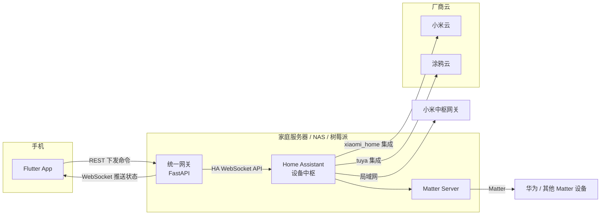

# 智能家居统一控制平台 — 架构设计

## 1. 目标

用一个移动 App（Android / iOS）统一控制三个生态的设备：

| 生态 | App | 本文简称 |
| --- | --- | --- |
| 小米 / 米家 | 米家（小米生活） | 小米 |
| 华为 HiLink | 华为智慧生活 | 华为 |
| 涂鸦 | 智能生活（Smart Life） | 涂鸦 |

App 中按房间、按平台浏览设备，完成开关、调光、空调、窗帘、风扇等常用控制，并实时看到状态变化。

## 2. 关键结论：各平台能否接入

这是整个项目最大的不确定性，决定了架构。

| 平台 | 官方开放程度 | 推荐接入方式 | 风险 |
| --- | --- | --- | --- |
| 小米 | 有官方 HA 集成 | Home Assistant 安装小米官方集成 [XiaoMi/ha_xiaomi_home](https://github.com/XiaoMi/ha_xiaomi_home)，用小米账号 OAuth 登录；有小米中枢网关时可局域网控制 | 低 |
| 涂鸦 | 开放程度最高 | HA 内置 `tuya` 集成，用「智能生活」App 扫码登录，不需要涂鸦开发者账号；需要本地控制可用社区的 `tuya-local` | 低 |
| 华为 | **没有面向第三方的设备控制接口** | 见下文 | **高** |

### 华为的情况

- 华为智慧生活开放平台（HiLink）面向**设备厂商**：它让厂商把自己的设备接进华为生态，而不是让第三方 App 从华为生态里读取、控制设备。个人或普通企业开发者拿不到「列出我家华为设备并控制」的接口。
- 可行的路线（按推荐顺序）：
  1. **Matter**：设备本身支持 Matter 时，通过 HA 的 Matter 集成接入（`docker-compose.yml` 已包含 Matter Server）。每个型号是否支持 Matter 需要单独确认。
  2. **品牌自有通道**：很多「HiLink 设备」其实是第三方品牌（照明、插座、窗帘电机等），品牌自己的云或 App 可能有 HA 集成，或同款设备有米家 / 涂鸦版本。
  3. **替换方案**：空调、电视等可用红外遥控器、智能插座间接控制。
  4. 不建议：逆向华为私有协议。违反服务条款，且随时可能失效。
- **建议**：开发前先列出家里（或目标用户）的华为设备清单，逐个型号确认走哪条路线。网关会根据 HA 中的设备厂商名（`HUAWEI`）把这些设备标记为「华为」。

## 3. 总体架构



### 为什么用 Home Assistant 做中枢

- 小米和涂鸦都有官方维护的 HA 集成，自己对接两家云 API 的工作量和维护成本远高于直接复用。
- HA 支持 Matter、Zigbee、HomeKit 等通用协议，华为及其他品牌的设备可以通过这些协议接入。
- 设备发现、令牌刷新、断线重连、局域网控制这些麻烦事都由 HA 处理。

### 为什么不让 App 直连 Home Assistant，而要加一层网关

- **统一设备模型**：HA 的实体模型很细（一个空调可能有十几个实体），网关把它们过滤、整理成 App 需要的「设备」，App 不需要理解 HA。
- **安全**：HA 的长期令牌权限极大（可以改配置、执行任意服务）。令牌只放在网关里，手机上只有一个只能控制设备的网关令牌。
- **可替换上游**：网关用适配器模式，以后如果某个平台需要直连云 API（比如拿到了华为的合作资质），只需加一个适配器，App 不用改。
- **扩展空间**：多用户、家庭共享、权限、操作日志、远程访问的云中继，都适合放在网关这一层。

## 4. 代码结构

```
backend/                 统一网关（Python 3.11+, FastAPI）
  gateway/
    models.py            统一设备模型：Device / Command / Platform / Action
    hub.py               DeviceHub：聚合适配器、设备缓存、事件广播
    main.py              REST + WebSocket 接口
    config.py            环境变量配置
    adapters/
      base.py            适配器接口
      home_assistant.py  HA WebSocket 客户端（鉴权、同步、订阅、重连）
      ha_mapping.py      HA 实体 <-> 统一设备 的转换规则
      mock.py            演示数据（三个平台各有设备）
  tests/                 单元测试 + 假 HA 服务的协议测试
mobile/                  Flutter App
  lib/
    models/device.dart          设备模型（与网关一致）
    services/gateway_client.dart REST / WebSocket 客户端
    state/device_store.dart     设备状态、断线重连、命令下发
    state/settings_store.dart   网关地址与令牌
    screens/                    首页（按房间分 Tab、按平台筛选）、设置页
    widgets/                    设备卡片、设备控制面板
docker-compose.yml       HA + Matter Server + 网关
```

## 5. 统一设备模型

```jsonc
{
  "id": "ha:light.living_room",      // "<适配器>:<原始ID>"，网关据此路由命令
  "name": "客厅吸顶灯",
  "type": "light",                    // light | switch | climate | cover | fan | sensor | binary_sensor
  "platform": "xiaomi",               // xiaomi | huawei | tuya | other
  "room": "客厅",
  "online": true,
  "state": { "on": true, "brightness": 80, "color_temp_kelvin": 4000 },
  "capabilities": ["turn_on", "turn_off", "toggle", "set_brightness", "set_color_temp"]
}
```

- `capabilities` 决定 App 显示哪些控件，App 不按设备型号写死逻辑。
- `state` 的字段约定见 `backend/gateway/models.py` 中 `Device` 的注释。
- 平台判断规则在 `ha_mapping.py`：先看 HA 集成名（`xiaomi_home`、`tuya` 等），再看设备厂商名。

## 6. 接口

所有接口（除 `/api/health`）需要 `Authorization: Bearer <GATEWAY_TOKEN>`。

| 方法 | 路径 | 说明 |
| --- | --- | --- |
| GET | `/api/health` | 健康检查 |
| GET | `/api/devices` | 设备列表 |
| GET | `/api/devices/{id}` | 单个设备 |
| POST | `/api/devices/{id}/commands` | 下发命令，返回 202 |
| GET | `/api/rooms` | 房间列表 |
| WS | `/api/ws?token=...` | 实时推送 |

命令示例：

```json
{ "action": "set_brightness", "params": { "brightness": 60 } }
```

| action | params |
| --- | --- |
| `turn_on` / `turn_off` / `toggle` | — |
| `set_brightness` | `brightness` 0–100 |
| `set_color_temp` | `color_temp_kelvin` 1500–9000 |
| `set_temperature` | `temperature` 5–35 |
| `set_hvac_mode` | `hvac_mode`：off / cool / heat / auto / dry / fan_only |
| `set_position` | `position` 0–100 |
| `set_fan_speed` | `percentage` 0–100 |
| `open` / `close` / `stop` | — |

错误码：401 令牌错误；404 设备不存在；422 参数错误或设备不支持该动作；502 下游平台执行失败（设备离线、HA 断开等）。

WebSocket 消息：连接后先收到 `{"type": "snapshot", "devices": [...]}`，之后是 `{"type": "device_updated" | "device_removed", "device": {...}}`。

**状态以推送为准**：命令接口返回 202 只表示已下发，App 不做乐观更新，等网关推送设备真实状态。这样设备执行失败时界面不会显示错误的状态。

## 7. 安全与远程访问

当前骨架面向局域网使用。上线到外网前需要：

1. **HTTPS**：网关前加反向代理（Caddy / Nginx）配证书；然后去掉 Android 的 `usesCleartextTraffic`。
2. **远程访问**，任选其一：
   - 组网方案：Tailscale / ZeroTier / WireGuard，最简单也最安全，适合自用；
   - 内网穿透：frp 等，需要自己的公网服务器；
   - 云中继：自建云端服务，家庭网关主动长连接到云端，App 连云端。面向多用户产品时采用。
3. **令牌**：App 目前把令牌存在 SharedPreferences，正式版换成 `flutter_secure_storage`（代码中已标 TODO）。多用户场景改为账号登录 + 短期 JWT。
4. 不要把 Home Assistant 的 8123 端口直接暴露到公网。

## 8. 路线图

| 阶段 | 内容 |
| --- | --- |
| 当前（骨架） | 统一模型、HA 适配器、Mock 演示、App 设备列表与控制、实时推送 |
| 下一步 | 确认华为设备清单与接入路线；部署 HA 并接入真实小米 / 涂鸦设备；按真实设备调整 `ha_mapping.py` |
| 功能 | 场景（一键离家 / 回家）、定时与自动化（可直接复用 HA 自动化）、设备排序与收藏、门窗 / 漏水等告警推送 |
| 产品化 | 账号体系与家庭共享、远程访问云中继、操作日志、App 上架（国内各安卓商店需软著） |

## 9. 已知限制

- 华为设备接入取决于设备本身是否支持 Matter 等通用协议，见第 2 节。
- 依赖厂商云的集成（小米、涂鸦的云端模式）在外网中断时不可用；有局域网控制能力的设备不受影响。
- 只映射常用设备类型；扫地机、门锁、摄像头等需要扩展 `DeviceType` 和对应的映射与界面。
